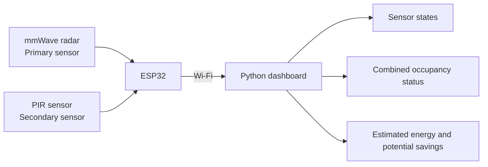

# Smart Classroom Energy Monitor

**An ESP32-based dual-sensor classroom occupancy monitoring concept with a proposed energy-waste estimation and evaluation framework.**

**Author:** Ashwath Krishna S  
**Project status:** Proposed student project; implementation and experimental validation are not yet documented.

## Overview

This project proposes a classroom occupancy-monitoring system using an ESP32, a mmWave radar sensor as the primary occupancy sensor, and a PIR sensor as a secondary sensor. The ESP32 is intended to send sensor readings over Wi-Fi to a Python dashboard.

The proposed system combines the two sensor signals to make conservative occupancy decisions and presents sensor states, combined occupancy status, inactivity duration, and estimated energy use. The energy figures are estimates based on appliance power ratings and assumed ON duration; they are not direct measurements from an energy meter.

## Proposed system architecture

## Proposed occupancy logic

- If either sensor reports credible presence, classify the room as **Occupied**.
- If signals are weak or conflicting, classify the state as **Uncertain**, keep the lights on, and show a warning.
- Declare **Vacant** only when both sensors indicate no presence continuously for the configured timeout.

This conservative approach is intended to reduce the risk of switching lights off while someone is still in the room. Exact thresholds and timeout values are not specified yet and must be selected and evaluated during implementation.

## Energy estimation

The proposed estimate is based on appliance rated power and the duration for which the appliance is assumed to be ON:

- Energy (kWh) = Power (W) × Time (hours) ÷ 1000
- Estimated cost = Energy (kWh) × Electricity tariff (per kWh)
- Potential saving = Estimated energy without the proposed control − Estimated energy with the proposed control

These calculations depend on the accuracy of the rated power, ON-duration assumptions, and tariff entered. They should not be presented as metered energy readings.

## Evaluation plan

The proposed evaluation compares a PIR-only approach with the dual-sensor approach under the same room conditions. Planned scenarios include:

- A person sitting still, reading, or writing
- A person entering and leaving the room
- An empty room while a fan is running
- Occupants at different distances from the sensors

Ground truth is to be recorded through observation. Planned metrics include false-vacancy events, false-occupancy events, time taken to declare vacancy, and the difference between estimated energy and a reference reading.

## Current scope and limitations

- This repository documents a **proposed design and evaluation plan**. It does not claim that a complete prototype has been built, tested, or validated.
- The method for confirming whether lights or fans are actually ON is unresolved. Possible approaches to investigate include a switch-state input, a current sensor, or a manual dashboard setting.
- mmWave performance depends on the selected module, mounting, room layout, and tuning. Moving objects such as fan blades may cause unwanted detections.
- PIR sensors detect changes in infrared radiation associated with movement and may fail to detect a person who remains still.
- Sensor thresholds, timeout values, appliance wattages, and electricity tariff are not specified in the available project material.

## Repository guide

| Folder/file | Purpose |
|---|---|
| `docs/` | Project overview, architecture, sensor selection, and occupancy logic |
| `hardware/` | Component notes and circuit-design considerations |
| `software/` | Proposed software implementation plan |
| `evaluation/` | Research question, methodology, and performance metrics |
| `presentation/` | Original project presentation |

## Suggested next steps

1. Select exact mmWave and PIR modules and record their datasheet details.
2. Complete and document the circuit and power requirements.
3. Decide how actual appliance ON-state will be confirmed.
4. Implement sensor acquisition and dashboard communication.
5. Run the planned tests and report measured results separately from estimates.

## License

This project is released under the MIT License. See [LICENSE](LICENSE).
