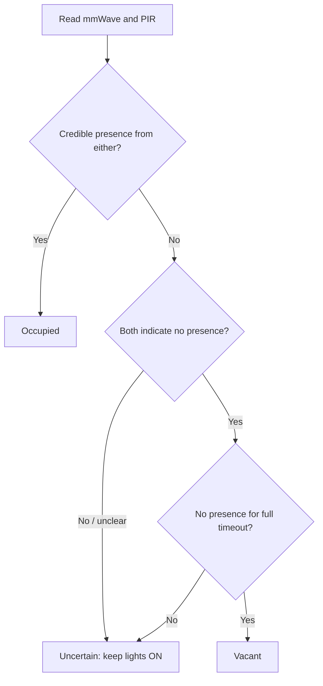

# Proposed Occupancy Logic

## States

- **Occupied:** either sensor reports credible presence.
- **Uncertain:** sensor evidence is weak or conflicting. Keep lights ON and display a warning.
- **Vacant:** both sensors indicate no presence continuously for the full configured timeout.

## Decision outline

## Safety-oriented design intent

The system should avoid declaring a room vacant based on a single sensor's inactivity. Weak or conflicting evidence should not trigger an automatic lights-off decision.

## Parameters not yet specified

The project material does not define numeric confidence thresholds, filtering windows, debounce periods, or the vacancy timeout. These must be selected, documented, and tested with the chosen hardware.
