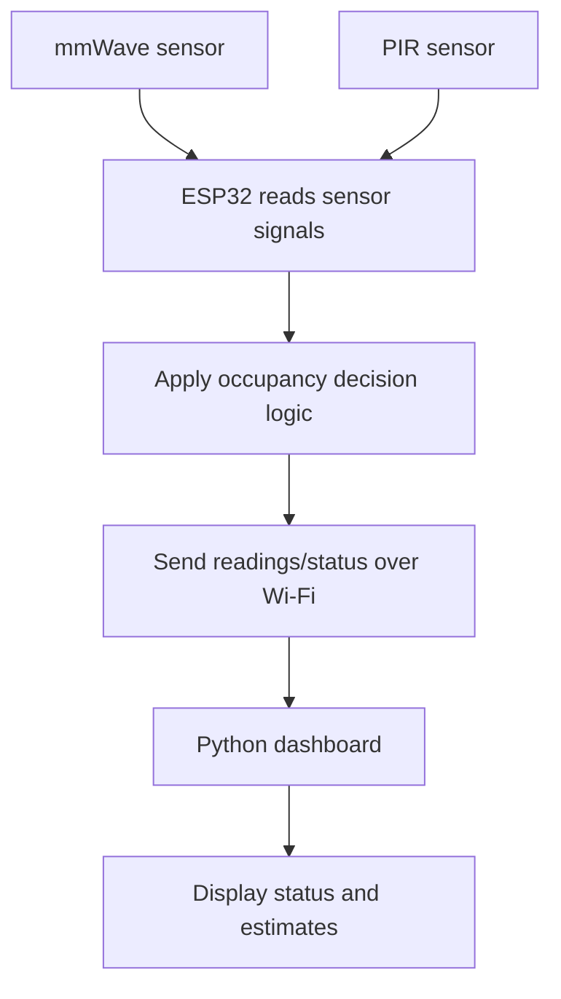

# System Architecture

## Main blocks

1. **mmWave radar sensor:** proposed primary sensor for detecting occupancy, including subtle movement where supported by the selected module and setup.
2. **PIR sensor:** proposed secondary sensor that detects changes in infrared radiation associated with movement.
3. **ESP32:** intended to read both sensors and apply the occupancy decision logic.
4. **Wi-Fi link:** intended communication path from the ESP32 to the dashboard.
5. **Python dashboard:** intended display for sensor states, combined status, inactivity duration, and estimated energy information.

## Data flow

## Design items still to be decided

- Exact sensor models and their electrical interfaces
- Sensor mounting positions and detection zones
- Communication protocol and message format
- Dashboard framework and data storage approach
- Method for confirming actual light/fan ON state
- Sensor thresholds, filtering, and vacancy timeout
